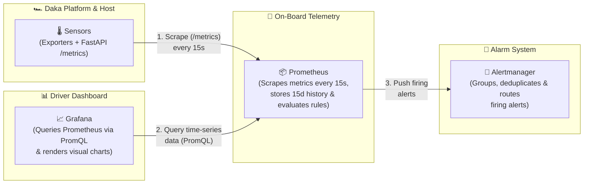
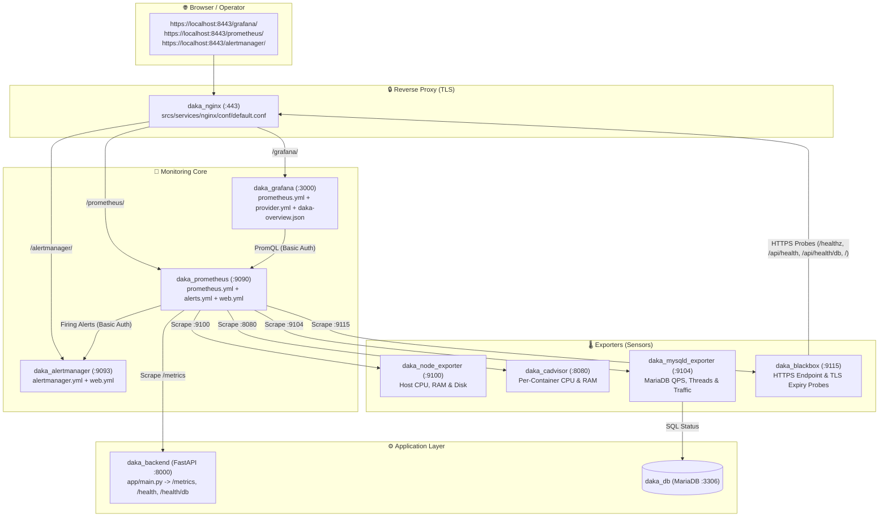
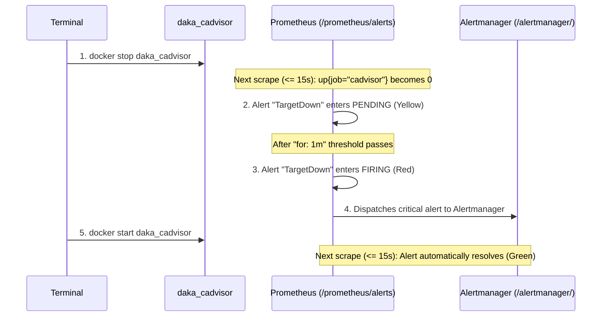

# Observability & Monitoring Stack (Prometheus, Grafana & Alertmanager)

This document explains the observability architecture in **Daka**, covering the role of each component, how the stack is implemented and configured in the repository, how to access the web interfaces, and step-by-step scenarios to observe live metrics and test alerts.

---

## 1. Overview & Core Concepts

To understand how the monitoring components work together, think of the platform as a **race car**:



### Component Roles
1. **Exporters & Application Instrumentation (The Sensors):**
   - Prometheus only collects metrics by making HTTP requests (`GET /metrics`) that return data in the Prometheus text exposition format. For services that do not expose `/metrics` natively (such as MariaDB, the Linux kernel, or Docker), **exporters** run as standalone "translator" containers that query the underlying target and expose its stats at `/metrics`.
   - Daka uses **4 dedicated exporter containers** plus **1 Python instrumentation library**:
     - [`node-exporter`](https://github.com/prometheus/node_exporter): Exports host-level hardware and OS metrics (CPU, memory, disk usage) read from `/proc` and `/sys`.
     - [`cAdvisor`](https://github.com/google/cadvisor): Exports per-container resource usage and performance metrics (CPU cores, working-set memory) directly from Docker/cgroups.
     - [`mysqld-exporter`](https://github.com/prometheus/mysqld_exporter): Connects to MariaDB (`db:3306`), runs status queries (`SHOW GLOBAL STATUS`), and translates database metrics (queries/sec, active threads, network traffic) into Prometheus format.
     - [`blackbox-exporter`](https://github.com/prometheus/blackbox_exporter): Probes public endpoints over HTTPS (`/`, `/healthz`, `/api/health`, `/api/health/db`) to verify external reachability, HTTP status codes, response latency, and TLS certificate expiration.
     - [`prometheus-fastapi-instrumentator`](https://github.com/trallnag/prometheus-fastapi-instrumentator): Embedded directly in the FastAPI backend ([`app/main.py`](../../srcs/services/backend/app/main.py)) to measure HTTP request rate, status code distribution, and latency histograms at `/metrics`.
2. **Prometheus (The Telemetry Brain & Time-Series Database):**
   - Pulls (*scrapes*) metrics from all configured targets every **15 seconds**, stores them locally for **15 days**, and continuously evaluates **10 alerting rules** across availability, host/container saturation, application RED metrics, and TLS certificate expiration.
3. **Grafana (The Visual Dashboard):**
   - Does not collect metrics itself. Instead, it connects to Prometheus as a data source and renders real-time visual panels (**Daka — Overview** dashboard), automatically provisioned from version-controlled JSON.
4. **Alertmanager (The Alarm Router):**
   - Receives firing alerts from Prometheus, groups related alerts by `alertname` and `job`, and applies inhibition rules (e.g., suppressing `warning` alerts on an instance that already has a `critical` alert firing).

---

## 2. Architecture & Implementation in Daka

All observability services run inside the isolated `daka_obs` Docker network defined in [`srcs/docker-compose.yml`](../../srcs/docker-compose.yml) and are exposed externally **exclusively over HTTPS** through the Nginx reverse proxy ([`srcs/services/nginx/conf/default.conf`](../../srcs/services/nginx/conf/default.conf)).



### Key Implementation Files

| Capability | Implementation in Daka | Repository Files |
| :--- | :--- | :--- |
| **Metrics Collection (Prometheus)** | Prometheus v3.1.0 scraping 9 jobs every 15s (`prometheus`, `node`, `cadvisor`, `mysqld`, `backend`, `blackbox-exporter`, `blackbox-http`, `alertmanager`, `grafana`). | • [`srcs/docker-compose.yml`](../../srcs/docker-compose.yml)<br>• [`srcs/services/observability/prometheus/prometheus.yml`](../../srcs/services/observability/prometheus/prometheus.yml) |
| **Exporters & Instrumentation** | • **FastAPI:** `Instrumentator().instrument(app).expose(app)` exposing `/metrics` + `/health` & `/health/db`.<br>• **Host:** `node-exporter` mounting `/proc`, `/sys`, `/`.<br>• **Containers:** `cadvisor` tracking Docker cgroups.<br>• **Database:** `mysqld-exporter` connected to MariaDB.<br>• **HTTPS & TLS:** `blackbox-exporter` probing public URLs. | • [`srcs/services/backend/app/main.py`](../../srcs/services/backend/app/main.py)<br>• [`srcs/services/observability/blackbox/blackbox.yml`](../../srcs/services/observability/blackbox/blackbox.yml)<br>• [`srcs/tools/gen-secrets.sh`](../../srcs/tools/gen-secrets.sh) |
| **Grafana Dashboards** | Auto-provisioned **Daka — Overview** dashboard covering 6 key operational areas: *Overview*, *Host*, *Containers*, *Endpoint & TLS*, *Application API (FastAPI)*, and *Database (MariaDB)*. | • [`srcs/services/observability/grafana/provisioning/datasources/prometheus.yml`](../../srcs/services/observability/grafana/provisioning/datasources/prometheus.yml)<br>• [`srcs/services/observability/grafana/provisioning/dashboards/provider.yml`](../../srcs/services/observability/grafana/provisioning/dashboards/provider.yml)<br>• [`srcs/services/observability/grafana/dashboards/daka-overview.json`](../../srcs/services/observability/grafana/dashboards/daka-overview.json) |
| **Alerting Rules & Routing** | **10 alerting rules** across 4 groups (`availability`, `saturation`, `application`, `tls`) routed to Alertmanager with severity-based inhibition rules. Receivers (`default`, `critical`) have no external destination by design; firing alerts are inspected in `/prometheus/alerts` and `/alertmanager/`. | • [`srcs/services/observability/prometheus/rules/alerts.yml`](../../srcs/services/observability/prometheus/rules/alerts.yml)<br>• [`srcs/services/observability/alertmanager/alertmanager.yml`](../../srcs/services/observability/alertmanager/alertmanager.yml) |
| **Access Security** | • No observability ports (`3000`, `9090`, `9093`) are published to the host; all traffic goes through Nginx HTTPS (`:8443`).<br>• Grafana requires admin login (`GF_USERS_ALLOW_SIGN_UP=false`).<br>• Prometheus and Alertmanager require HTTP Basic Auth (`web.yml` with bcrypt password hash generated by `gen-secrets.sh`).<br>• Raw `/metrics` endpoints (`/api/metrics`, `/grafana/metrics`) return `404` on Nginx and are accessible exclusively on the internal `daka_obs` Docker network. | • [`srcs/services/nginx/conf/default.conf`](../../srcs/services/nginx/conf/default.conf)<br>• [`srcs/services/observability/prometheus/web.yml.template`](../../srcs/services/observability/prometheus/web.yml.template)<br>• [`srcs/tools/gen-secrets.sh`](../../srcs/tools/gen-secrets.sh) |

---

## 3. Accessing the Interfaces

Once the stack is running (`make up`), all interfaces are accessible over HTTPS (port `8443` by default):

| Service | URL | Credentials (defined in `srcs/.env`) | Where to Navigate |
| :--- | :--- | :--- | :--- |
| **Grafana** | `https://localhost:8443/grafana/` | `GRAFANA_ADMIN_USER`<br>`GRAFANA_ADMIN_PASSWORD` | Left sidebar ➔ **Dashboards** ➔ **Daka** ➔ **Daka — Overview** |
| **Prometheus** | `https://localhost:8443/prometheus/` | `PROM_USER`<br>`PROM_PASSWORD` | • **Status ➔ Targets** (`/prometheus/targets`)<br>• **Alerts** (`/prometheus/alerts`) |
| **Alertmanager** | `https://localhost:8443/alertmanager/` | `PROM_USER`<br>`PROM_PASSWORD` | View active grouped alerts and silences |

> **Note on Alertmanager receivers:** The `default` and `critical` receivers intentionally have no external notification target (such as email, Slack, or webhooks) so the entire stack runs out-of-the-box without external third-party credentials. Active and grouped alerts remain directly visible in `/prometheus/alerts` and `/alertmanager/`.

To quickly check the configured credentials on your machine, run:

```bash
grep -E "^(GRAFANA_ADMIN_|PROM_)" srcs/.env
```

---

## 4. Hands-On Verification & Testing Guide

Use the following practical checks and live scenarios to verify and demonstrate the monitoring stack in action.

### 4.1. Offline Configuration Validation (`make validate`)

Before or without starting the full stack, you can validate the Docker Compose file, the Prometheus configuration (`promtool check config`), all 10 alert rules (`promtool check rules`), both Basic Auth web configurations (`promtool check web-config`), and the Alertmanager configuration (`amtool check-config`) with a single command:

```bash
make validate
```

### 4.2. Scenario 1: Observing Live Application & Database Traffic in Grafana

1. Open **Grafana** at `https://localhost:8443/grafana/` and navigate to **Dashboards ➔ Daka ➔ Daka — Overview**.
2. In the top-right time range picker, change the range from `Last 1 hour` to **`Last 15 minutes`** (and optionally set auto-refresh to `10s` or `30s`).
3. Scroll down to the **`Application API (FastAPI)`** and **`Database (MariaDB)`** rows.
4. In another browser tab, open the Daka web app (`https://localhost:8443/`) and interact with the platform:
   - Click through the **category chips** and use the **location autocomplete filter** on the Home page;
   - Open a listing detail page (`/listing/1`) or visit a non-existent listing (`/listing/999999`) to generate a `404` (`4xx` status).
   - Or run a quick burst of requests from the terminal:
     ```bash
     for i in $(seq 1 15); do
       curl -sk https://localhost:8443/api/listings > /dev/null
       curl -sk https://localhost:8443/api/listings/categories > /dev/null
       curl -sk https://localhost:8443/api/listings/999999 > /dev/null
     done
     ```
5. Refresh the Grafana dashboard after ~15 seconds (one Prometheus scrape cycle) and observe:
   - **`API Request Rate (req/s)`:** Spikes separated by route (`GET /listings`, `GET /listings/categories`, `GET /listings/{id}`).
   - **`API Responses by Status (req/s)`:** Separate lines for `2xx` (successful requests) and `4xx` (the `404` requests).
   - **`API Latency p95 by Route`:** Real response times in milliseconds/seconds per endpoint.
   - **`MariaDB Queries / sec` & `MariaDB Network Traffic`:** Corresponding database query spikes generated by SQLAlchemy.

---

### 4.3. Scenario 2: Triggering a Real Alert (`Inactive` ➔ `Pending` ➔ `Firing`)

You can verify that alert rules fire and route properly by temporarily stopping the `daka_cadvisor` container:



#### Step-by-step commands:
1. Open **`https://localhost:8443/prometheus/alerts`** in your browser. Verify that all 10 rules are currently **Green (`0 active`)**.
2. Stop the `daka_cadvisor` container from your terminal:
   ```bash
   docker stop daka_cadvisor
   ```
3. Wait **up to 15 seconds** and refresh `/prometheus/alerts`:
   - The **`TargetDown`** rule under the `availability` group will turn **Yellow (`1 pending`)** because `up{job="cadvisor"} == 0`.
4. Wait **1 minute** (the configured `for: 1m` duration in [`alerts.yml`](../../srcs/services/observability/prometheus/rules/alerts.yml)) and refresh `/prometheus/alerts`:
   - **`TargetDown`** turns **Red (`1 firing`)**.
   - Open **`https://localhost:8443/alertmanager/`** (using the same `PROM_USER` / `PROM_PASSWORD` Basic Auth credentials as Prometheus) to see the active `TargetDown` alert received and grouped by Alertmanager.
   - In **Grafana** (`Daka — Overview`), the **`Targets Up`** stat panel in the top row drops by 1.
5. Start the container again to restore normal operation:
   ```bash
   docker start daka_cadvisor
   ```
   Within 15 seconds, the target returns to `UP` and the alert automatically resolves back to **Green (`Inactive`)**.
