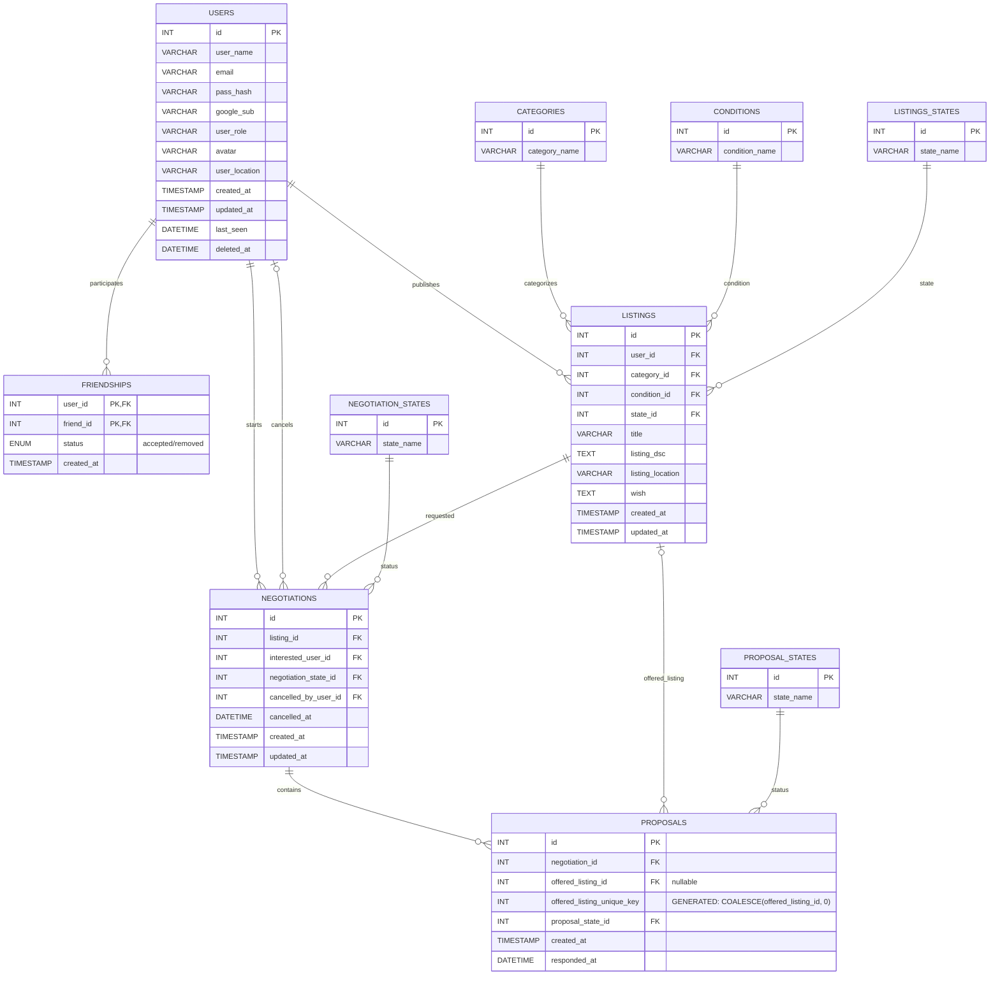
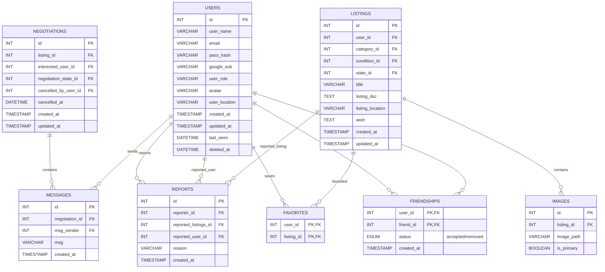

# DAKA - Entity-Relationship Model

## Entity Relationship Diagram - Core Data Model

`PROPOSALS` has a composite unique constraint on
`(negotiation_id, offered_listing_unique_key)`. The generated key normalizes a
missing `offered_listing_id` to `0`, allowing at most one proposal without an
offered listing per negotiation while also preventing the same listing from
being offered twice in that negotiation.

 
 

## Entity Relationship Diagram - Support Data Model

